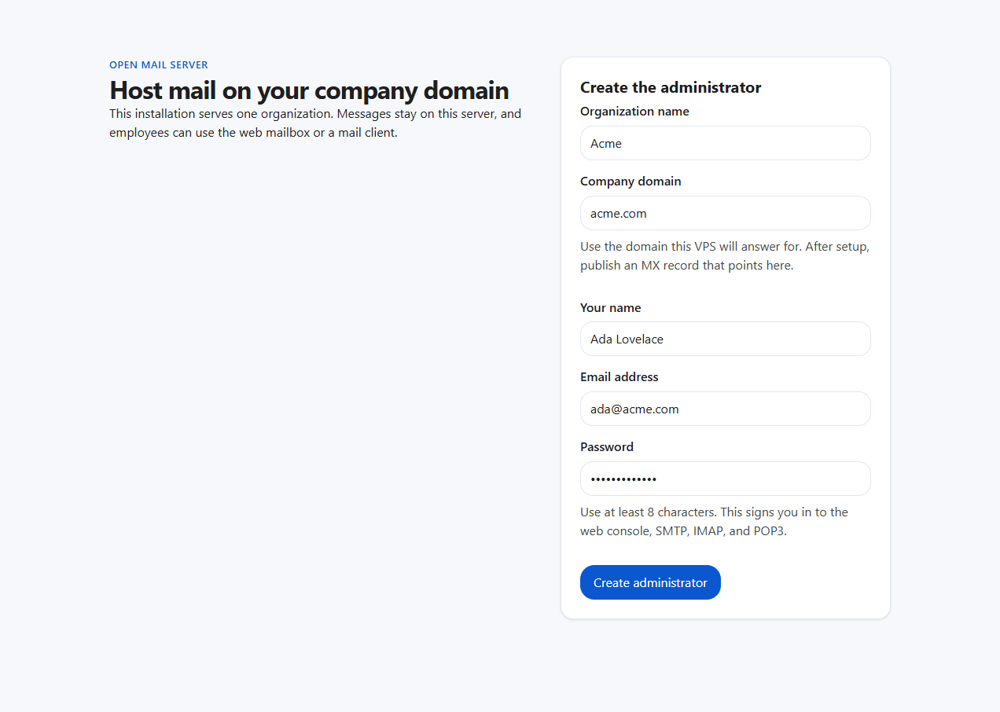

# Open Mail Server

Host your company email on your own server. You can read and send mail in the browser, and you can also use the mail app on Android or iOS.



## Install

You can let an AI do the install, or start it yourself with Docker Compose.

### Let an AI install it

The install notes are in [docs/install-open-mail-server/SKILL.md](docs/install-open-mail-server/SKILL.md). Open this repository with your AI tool and ask it to install Open Mail Server on your VPS. It will ask for the server address, the username, and the password, then connect over SSH. If Docker is missing, it installs Docker, copies this project, and starts the container.

Use an account that can administer that server. The password is only used for that SSH connection.

### Docker Compose

This repository already includes `docker-compose.yml`. `NET_BIND_SERVICE` lets the container listen on the mail ports without running as root.

```yaml
services:
  email-server:
    image: zymethyang/open-mail-server:v1.1.0
    restart: unless-stopped
    cap_add:
      - NET_BIND_SERVICE
    ports:
      - "25:25"
      - "465:465"
      - "587:587"
      - "143:143"
      - "993:993"
      - "110:110"
      - "995:995"
      - "443:443"
    volumes:
      - ./data:/opt/email-server/data
```

From that directory, run:

```bash
docker compose up -d
```

Compose downloads the published image. It does not build one on your server.

Your mail is stored in `./data` on the host. Inside the container that folder is `/opt/email-server/data`. Keep `data/storage-key` with it. That file is 32 bytes, and the stored mail can only be opened when it is there.

Open `https://your-server` in a browser. The certificate is self-signed, so the browser will warn you. Continue past that warning. The first page creates the company and the administrator account. Enter the company domain, this server's public IP address, and the administrator's email. The DNS guide and the port check use that address, and DMARC reports are sent to that email.

## Connect a mail app

Use SSL/TLS. On both the incoming and outgoing servers, the username is the full email address. The phone will warn about the certificate until you upload one from a certificate provider. That is in the FAQ below.

| Direction | Protocol | Host | Port | Security |
| --- | --- | --- | --- | --- |
| Incoming | IMAP | your mail hostname | 993 | SSL/TLS |
| Incoming | POP3 | your mail hostname | 995 | SSL/TLS |
| Outgoing | SMTP | your mail hostname | 465 | SSL/TLS |

### Web

Sign in at `https://your-server`, then open **My mailbox**.

### Android

1. Open the Gmail app.
2. Tap your profile picture, then **Add another account**, then **Other**.
3. Enter the full email address and the mailbox password.
4. Choose **Personal (IMAP)**. For POP3, choose **Personal (POP3)** and use port 995 in the next step.
5. For the incoming server, enter the mail hostname, port **993**, and security **SSL/TLS**. The username is the full email address.
6. For the outgoing server, enter the mail hostname, port **465**, and security **SSL/TLS**. Turn sign-in on. The username is the full email address, and the password is the mailbox password.

### iOS

1. Open **Settings → Apps → Mail → Mail Accounts → Add Account**. On older iOS, open **Settings → Mail → Accounts → Add Account**.
2. Tap **Other**, then **Add Mail Account**.
3. Enter your name, the full email address, the mailbox password, and a short description.
4. Tap **Next**, then choose **IMAP**. Choose **POP** only if you want POP3.
5. For Incoming Mail Server, the host is the mail hostname and the user name is the full email address.
6. For Outgoing Mail Server, use the same host and the same user name.
7. Tap **Next**, then **Save**.
8. Open the new account, tap it again, then open **Advanced** under the incoming settings. Turn **Use SSL** on. Set the port to **993** for IMAP, or **995** for POP3.
9. Go back, open **SMTP**, tap the primary server, turn **Use SSL** on, and set the port to **465**. Turn authentication on.

## FAQ

### I can't send email

Many internet providers block outgoing mail. Ask yours to allow it, or send through a relay such as SendGrid or Amazon SES. In the web console, open **Settings**, then **Outgoing relay**. Turn the relay on and save the host, username, and password. Use port 587 with STARTTLS, or port 465 with TLS.

### The browser says the site is not secure

The server starts with a self-signed certificate. Buy one from a certificate provider such as SSLs.com or Comodo. In the web console, open **Settings**, then **Certificate**, then **Upload certificate**. Upload the certificate and the private key. If the provider sent the intermediate certificates as a separate file, upload that too.

### I found a bug

Open a ticket in [GitHub Issues](https://github.com/tringuyen/email-server/issues).

## License

[MIT](LICENSE)
